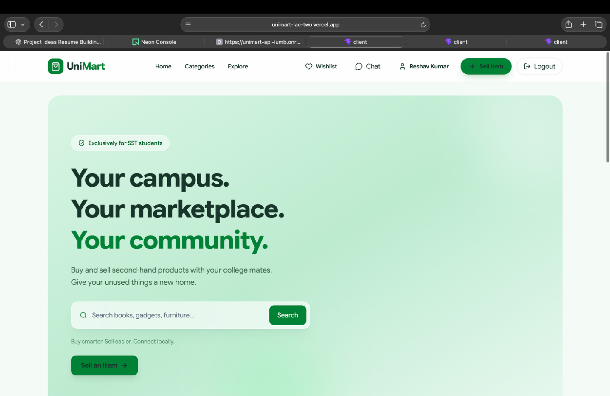
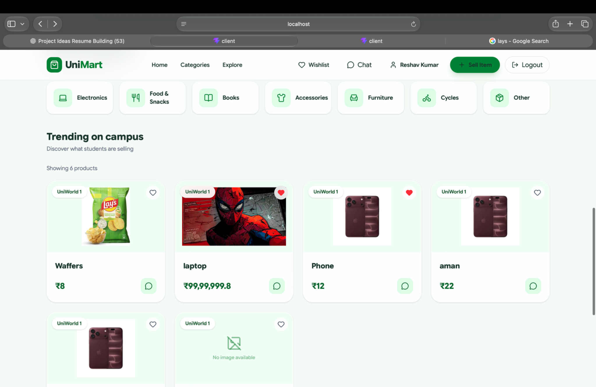
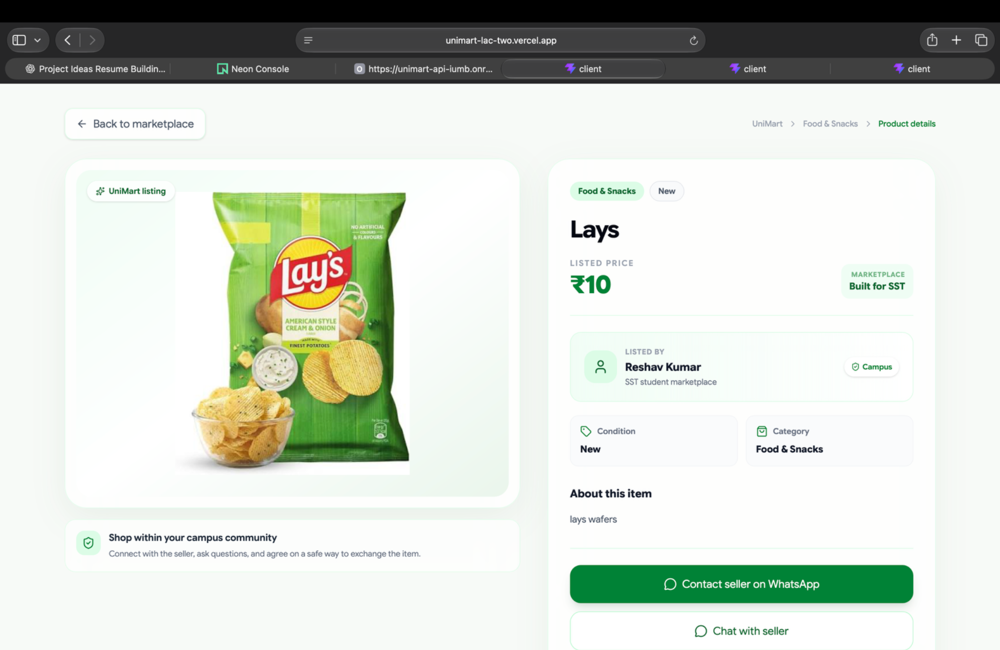
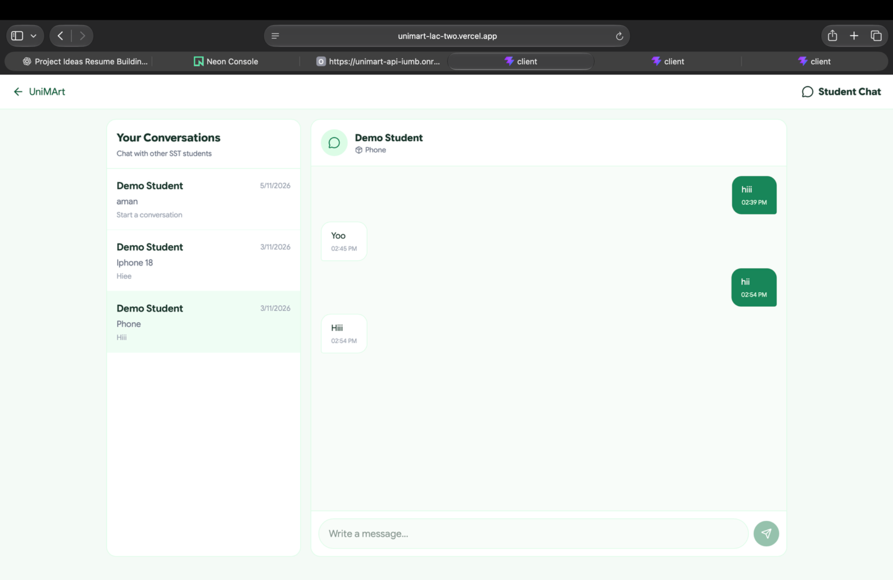
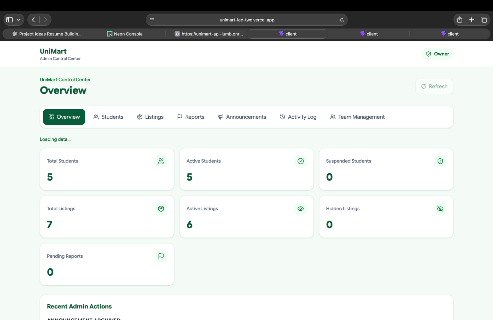
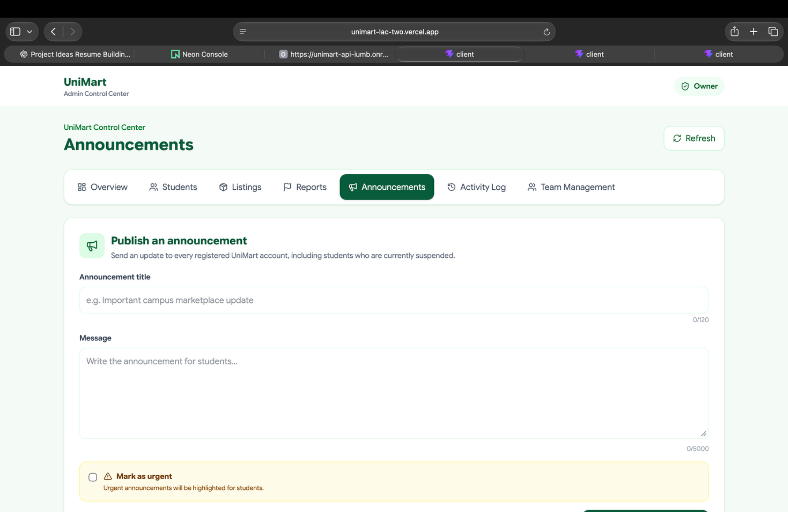

# UniMart — Built for SST

A marketplace made for SST students, where buying and selling things within the college community becomes easier.

**Live Website:** https://unimart-lac-two.vercel.app
**GitHub:** https://github.com/reshevk/UniMart

## Why I built UniMart

Students often use WhatsApp groups to sell things they no longer need. But finding a particular item, keeping track of listings, or contacting the right seller can get messy.

I wanted to build something more organized.

That's how **UniMart** started — a marketplace where SST students can list items, explore what others are selling, and connect with each other in one place.

## Features

- SST college email registration and OTP verification.
- Browse products listed by other students.
- Create listings with images, prices, descriptions, and hostel details.
- Filter products by UniWorld 1 and UniWorld 2.
- Save products to a wishlist.
- Chat directly with sellers in real time.
- Manage your own listings.
- Report inappropriate listings or users.
- Admin dashboard for moderation and announcements.
- Admin team management with different permissions.

## Screenshots

### Homepage


### Marketplace


### Product Details


### Student Chat


### Admin Dashboard


### Announcements


## Technologies Used

**Frontend**
- React
- Vite
- Tailwind CSS
- React Router
- Axios
- Socket.IO Client

**Backend**
- Node.js
- Express.js
- Prisma ORM
- PostgreSQL
- Socket.IO
- JWT
- bcryptjs

**Services**
- Neon — Database hosting
- Vercel — Frontend deployment
- Render — Backend deployment
- Brevo — Email verification
- Cloudinary — Image storage

## How it works

UniMart has a React frontend connected to an Express backend.

The backend handles authentication, product listings, user permissions, and other application logic. PostgreSQL stores the data, Prisma handles database operations, and Socket.IO enables real-time chat.

I also built an admin dashboard to help manage users, listings, reports, announcements, and team permissions.

## Run Locally

**Prerequisites**
- Node.js and npm
- PostgreSQL database
- Brevo account
- Cloudinary account

**1. Clone the repository**

```bash
git clone https://github.com/reshevk/UniMart.git
cd UniMart
```

**2. Set up the backend**

```bash
cd server
npm install
```

Create a `.env` file with the required database, JWT, Brevo, and Cloudinary environment variables.

Then run:

```bash
npx prisma generate
npm run dev
```

**3. Set up the frontend**

Open another terminal:

```bash
cd client
npm install
npm run dev
```

Configure the frontend API URL to point to your backend.

## What I learned

Building UniMart gave me practical experience with:

- Full-stack application development.
- REST API design and integration.
- Database design and Prisma ORM.
- Authentication and email OTP verification.
- Real-time communication using Socket.IO.
- Image uploads and cloud storage.
- Role-based access control.
- Testing and deploying a full-stack application.

It started as an idea to solve a small problem in my college community, but became a project that helped me understand how different parts of a real-world application work together.

---

**UniMart — Built for SST**
